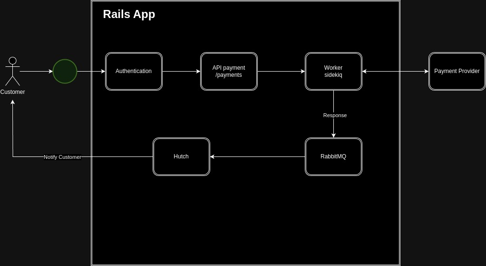
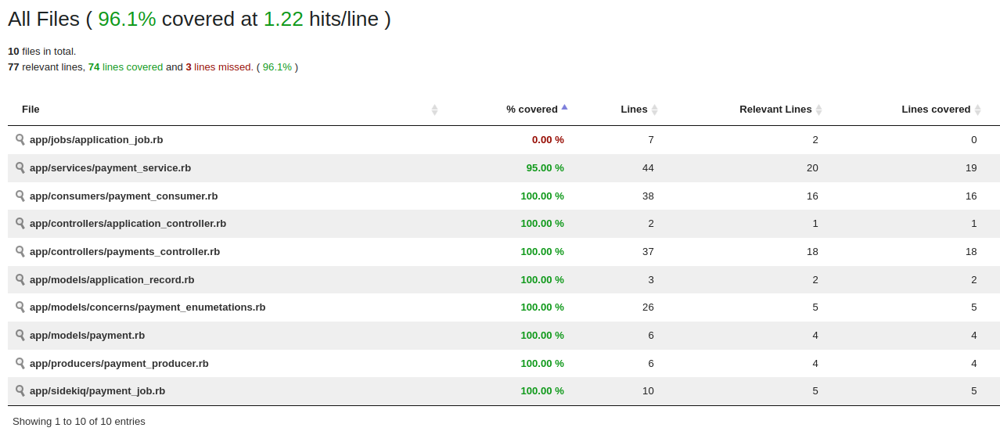

# README

## Payment on Rails
- A Rails app for accepting payments

### Ideas
- Use json to configure contracts
- Abstract external contracts to intermediary abstration (adapter)
- Use json schemas to map external contracts to internal contract
- Use configuration to abstract authentication

#### Objectives
  - Use a strategy like pattern to connect to many payment providers based on configuration, implementing as less as possible details of contracts.

### Ruby version
- 3.3.0

### Rails version
- 7.1.3

### Application dependencies
- pg
- redis
- sidekiq
- hutch
- enumerize
- faraday
- rspec
- factory_bot
- money
- simple_cov
- webmock
- rubocop

### Service dependencies
- PostgreSQL
- Redis
- RabbitMQ

### Services (queues)
- Sidekiq
- Hutch 

### Deployment 
- Github actions
- AWS

### How to run the app
- `bundle exec rails s -b '0.0.0.0'`

### How to run the sidekiq
- `bundle exec sidekiq config/sidekiq.yml`

### How to run the hutch
- `bundle exec hutch`

### How to run the test suite
- `bundle exec rspec`

## Architecture

## Code coverage

